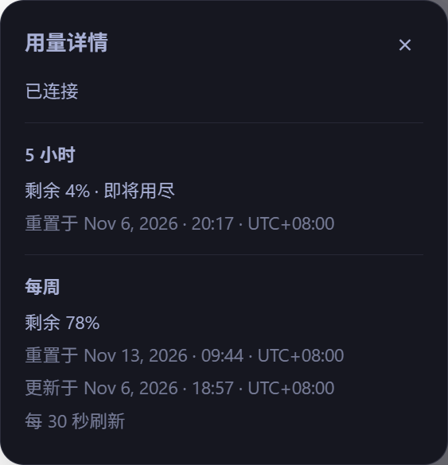

# Windows x64 P0 实测报告

日期：2026-11-05（Asia/Shanghai）。当前结论：**部分通过，尚未达到平台 Go 门槛。**

## 2026-11-06 主输入语义与最新人工验收

最新接线在原生Renderer取得真实双窗口。目标栏展开时，Composer外围出现辅助编辑器；通过明确data-codex-composer标记确认主输入，不将其他编辑区混入候选。外围约736×397.8px、主输入约712×40px、辅助编辑区约536.8×18.9px，尺寸均保持，仅整体上移32px。文字栏恢复、无按钮；侧栏2个按钮，当前深色主题两处无障碍周期文本均存在，下方无button角色。

用户在本聊天人工确认Esc关闭详情且焦点返回圆环。此前CDP键盘失败记录表示自动输入通道未能完成该验证，不再作为实际键盘失败结论；其他键盘场景仍待测。

以下截图仅包含空输入控件/额度UI，已排除目标正文、聊天、账号和头像；是当前原生深色主题的局部证据，不替代所有主题、尺寸及缩放矩阵。

更新时间修复后，真实详情显示有效成功取数时间与UTC+08:00，刷新说明仅为“每 30 秒刷新”。下图为2026-11-06采集的有限额度字段，不含原始响应或账号信息。

## 2026-11-06 原生 Renderer 续测

本次已成功通过固定 Loader 进入当前原生 Windows x64 Codex 26.1029.7803.0；监督进程及实际应用进程均回读存活，应用包含 CDP 参数，Loader 完成监听器所有权校验。此前“尚未启动 Loader”的记录仅描述 11 月 5 日采样轮次，不再代表当前状态。

| 项目 | 实际结果 | 结论边界 |
| --- | --- | --- |
| Loader 生命周期 | 本项目探针状态 running；默认示例未启用 | 注入成功，不等于额度或挂载通过 |
| 初次执行 | Composer/rail 均 missing；HTTP 候选为 0 | document-end 仍可能早于宿主 UI 挂载 |
| UI 就绪后通过固定 Loader wrapScript(force) 重载 | Composer 和 rail 各 1 个可见候选，均 code=space；HTTP 候选仍为 0，usage 错误 missing | 排除“仅等待初始挂载即可修复”的解释 |
| 实际视口 | 1118 × 784 CSS px，devicePixelRatio=1.875 | 与早期进程参数的缩放记录分开，不能互相替代 |
| Composer 几何 | bottom≈764，距视口底部≈20px | 当前保守规则要求底部额外 60px，未满足 |
| Rail 几何 | 宽≈52px；容器 bottom≈780，末尾子区 bottom≈776 | 当前规则要求末尾额外 60px，未满足；未改动原生布局 |
| 同源模块结构 | 4 个数字命名 ESM 入口；其中一个导出 __webpack_require__，缓存模块 10298 个、getter 导出 20445 个 | 当前仅扫描前 256 个缓存记录且不执行 getter，零候选不能证明接口本身不存在 |

当前适配器的实测结论为 **No-go**：尚未取得 Renderer 主池样本，未插入任何标记，没有达到原生 Usage 同账号对照或双挂载要求。下一步应先评估当前 Rspack ESM 的缓存导出适配，以及在不破坏原生输入/菜单前提下是否存在可用布局；不得把诊断失败包装成已通过，不直接引入 Rust 或常驻 App Server。

本轮结束时通过 Loader 注册表禁用本项目探针并回读清理结果；监听器、几何与模块诊断均不导出聊天正文、账号、email 或凭据。尚无成功挂载截图、真实键盘/输入/发送验收或 30 分钟稳定性证据。P1 独立核心已另行实现并测试，仍未进行平台整合。

## Rspack 数据能力续测（2026-11-06）

新增 rspack-esm-v1 适配后，当前客户端确认唯一 HTTP 客户端；不调用模块工厂，仅在已缓存导出中接受零参数且返回单一标识符的 live-binding getter。缓存记录超过 16384 或导出检查超过 131072 时拒绝整次扫描，不将部分结果视为唯一。跳过缓存中的 Window 导出；转译模块可能未带 __esModule，不能仅依赖该标志。当前样本发现一次耗时约 82ms，仅代表本次测量，尚非持续稳定性结论，正式轮询不应每次重新发现。

通过该唯一客户端执行固定 GET /wham/usage 成功。requestedAt=1793928350、fetchedAt=1793928351；5H duration=18000、used=35、remaining=65、reset=1793944482；Weekly duration=604800、used=73、remaining=27、reset=1793929409。Normalizer 输出 both/normal，无诊断。输出均来自同一 Renderer 响应，没有拼接独立 App Server 结果。未导出完整响应、账号或凭据。

这证明当前 Renderer 固定读路径可用，推翻“当前适配器始终无客户端”的阶段性结果；整体平台仍未 Go：账号及原生 Usage 同时段对照、布局解释、两个挂载位置与交互验收仍待完成。此阶段数据能力检查使用短暂 CDP 求值，无额外 DOM 或监听器残留；Loader 注册表中的早期 P0 插件仍保持禁用。

## 双挂载与输入续测（2026-11-06）

用户已在本聊天明确批准采用实测布局：编辑器和原生 Composer 尺寸不变，外围新增约 64px、整体上移；52px rail 内按实际可用内宽适配为 36px。该决定取代第 5 节的待确认布局解释，不能再以外围高度或固定 40px 标记阻止实现。

- `composer-flow-v2` 以唯一原生 Composer、已确认的 thread-find-composer/footer 流式容器挂载 sibling，保留编辑器宽高，仅允许明确的垂直位移和宿主时间线滚动补偿；尺寸变化、遮挡或非预期位移则同步回滚。
- `navigation-rail-flex-v2` 利用包含原生 sidebar destination 的增长容器空白，在 footer 前插入；先前 40px 标记会撑宽 rail 已实测撤销，新实现按 footer 与内宽约束为 36px。
- 真实实验中编辑器始终约 712×40px、Composer 始终约 736×130.53px，Composer 顶部由约633.47变为569.47，rail始终约52px。零控件尺寸变化、零重叠；时间线内容随原生 footer 预留空间产生位置补偿，不能将此记成“全页面位置不变”。移除后 root/editor/rail 几何全部恢复，残留0。
- 对实际编译后的两个 v2 适配器分别回读 mounted=true；双标记并存时在原生空编辑器输入固定 `P0 验证` 成功，Ctrl+Z 后回到空草稿，原生按钮节点仍连接；finally 清理后标记0、输入为空。未点击发送或停止，当前运行中的目标没有被测试消息打断，实际发送路径仍未验证。
- 在编辑器为空时采集了两个真实裁剪截图，保存在忽略的本地诊断目录；已查看。截图为 P0 标记，并非正式圆环或 Popover，不据此宣称 P2 已完成。
- 一次观察等待 requestAnimationFrame 因客户端后台状态超过 CDP 超时；重新观察确认客户端仍运行，先清除本项目标记，再用有界等待复测成功。该观察超时不等于应用退出。

原生 Usage 对照：同一 Renderer 原生用量按钮 aria-description 和实际菜单显示 5H剩余62%、Weekly剩余27%；紧接固定 GET 的 requestedAt=1793928589、fetchedAt=1793928590，响应为61%/26%，reset分别1793944482/1793929409。原生菜单未显示 reset，不能断言重置时间一致；未证明原生菜单刚更新，1个百分点差异按采样/缓存时差保留为待核对，不判 degraded。当前已有真实数据、两个安全挂载位置与输入/撤销证据；完整原生对照、实际发送、重建、多主题/尺寸、账号切换和平台最终 Go 报告仍待完成。

## 文字栏最终重叠布局（2026-11-06）

用户将Composer明确调整为：输入框外侧下方只显示文字剩余量，圆环仅在侧栏；进一步要求两个圆角矩形部分重叠、无间隙、文字右对齐。此决定已记入 [UI设计决策](../UI设计决策.md)，取代此前下方圆环、控制栏入口和分离文字栏的历史方案。

当前源组件经原生短暂预览：两个位置共4个入口；Composer与编辑器原有宽高均保持；原生按钮中心点仍可命中；Composer矩形约736×130.53px，信息栏外层约736×44px，两者实际重叠11.99995px、可见下扩约32px。Composer内SVG数量0，侧栏SVG数量2。截图已查看；finally回读slots=0、views=0、styles=0。所有数值来自本次实际Renderer响应，没有固定为示例百分比。

装饰重叠区域使用透明背景、不接收鼠标事件；可交互文字区域在原生框下方。最初一次检查将原本已被原生footer遮住的聊天按钮当作新阻挡，已改为依据插入前的实际中心命中区分可交互控件，尺寸、位置及可交互区域重叠检查仍保留，并新增合法装饰重叠与非法交互侵入的回归用例。完整项目135项测试、282个断言通过，类型检查及P0构建通过。

## 真实环境

- 当前原生应用：Codex 26.1029.7803.0，Windows x64；进程参数中的设备缩放为 1.5、语言为 zh-CN，主题未采集。未导出完整命令行、用户目录或账号标识。
- 当前应用启动未包含 remote-debugging 参数；尚未安装或启动 Loader，未重启应用、未注入 Renderer。
- 探针使用已有原生 Windows Node 24.22.1 和原生 Codex CLI，通过 WSL 调用 Windows 可执行文件。数据请求发生于原生 Windows App Server，不以 WSL CLI 失败替代本结果。
- 两次原生探针均完成 initialize → initialized → account/read → account/rateLimits/read → account/read；账号只在内存比较，不导出身份。

## 白名单采样

以下是同一实现连续两次真实请求，不是 UI 截图或原生 Usage 对照。Unix 时间单位为秒；fetchedAt 为客户端成功取得时间。

| 采样 | requestedAt | fetchedAt | 300 分钟 used / remaining / reset | 10080 分钟 used / remaining / reset |
| --- | --- | --- | --- | --- |
| 1 | 1793853378 | 1793853381 | 40 / 60 / 1793858593 | 66 / 34 / 1793929409 |
| 2 | 1793853490 | 1793853492 | 41 / 59 / 1793858593 | 66 / 34 / 1793929409 |

两次主池识别为 both、quality=normal；第二次 5H 消耗增加属于独立采样事实，不据此判冲突。探针完成后原生进程清单中匹配探针启动参数的独立 App Server 数为 0。未验证该连接的通知能力，明确为 polling-only。

## 自动化验证

- TypeScript 严格类型检查通过。
- 85 项测试通过（142 个断言；以后以当前测试输出为准）：数据边界、账号变化、stdio 分块、超时/退出/协议错误、脱敏、模块能力识别、锚点拒绝条件、插入后重叠回滚、CJS 生命周期、Node bundle 入口。
- Bun Renderer CJS 与 Node ESM bundle 构建通过。
- 固定 Loader b6ec28c69af12e9667f57d19823fb46d225756e4 的 `loadScriptDescriptor` 实际接受生成包，runAt=document-end、permissions=[dom]；不是仅自行检查字段。
- 原生 Windows Node 运行独立 Loader 注册表准备脚本成功，探针 enabled=true、上游默认示例 enabled=false；只初始化临时测试目录，未启动 Loader 会话。Linux 重复运行同一准备目录会拒绝继续，避免覆盖现有插件状态。
- happy-dom 模拟几何用于生命周期单测；未运行真实浏览器 E2E。模拟 DOM 不能证明原生布局、焦点或输入/发送行为。
- 同一探针在 WSL 默认 CLI 环境初始化阶段退出，错误码 exit；未导出原始 stderr，该失败不推断为认证问题。

## 未通过的门槛

尚无 Renderer `/wham/usage` 样本、与原生 Usage 的同账号同时段对照、唯一真实锚点诊断、UI 截图、双挂载视觉/输入/发送/焦点验证、启停/任务重建实测、两主题与尺寸/缩放验证、真实网络/限流结果、30 分钟稳定性观察。

因此 Windows P0 不能标通过，P1/P2 平台整合与 P3 正式发布尚未开始。macOS Apple Silicon 与 Windows ARM64 均未验证，不能继承 x64 独立 App Server 结果。
